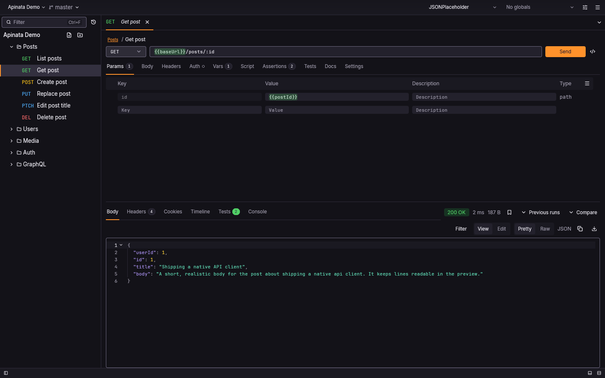
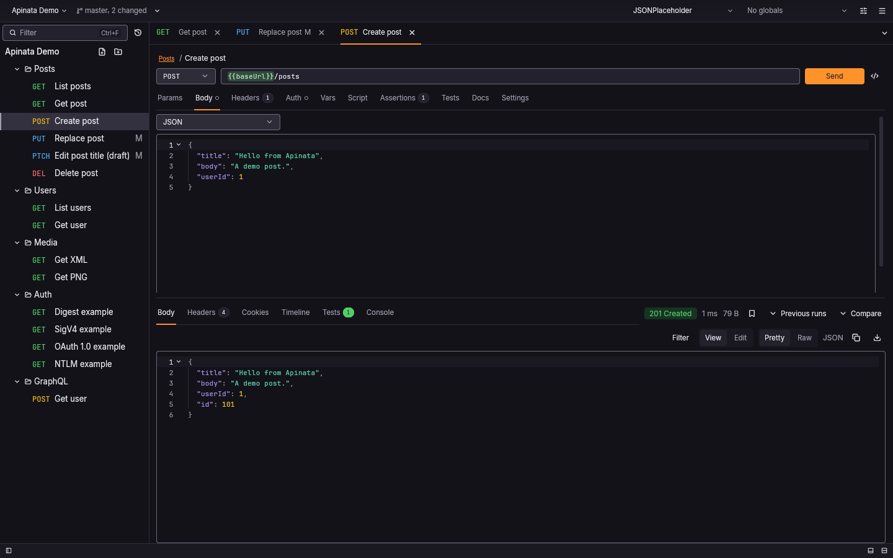
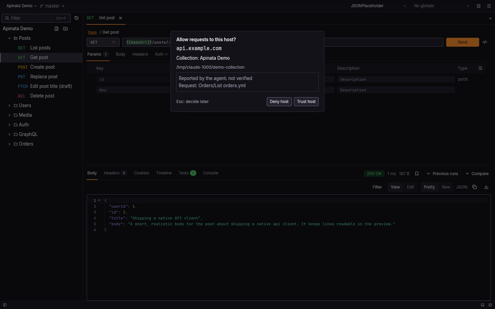
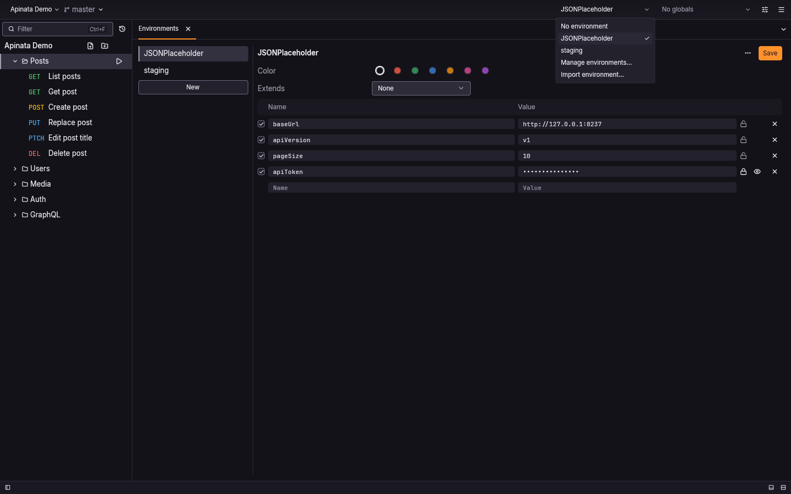
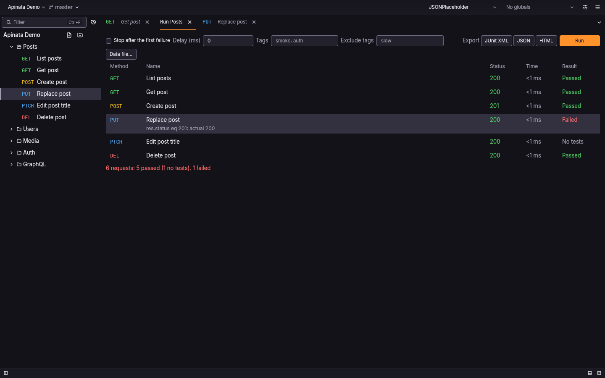
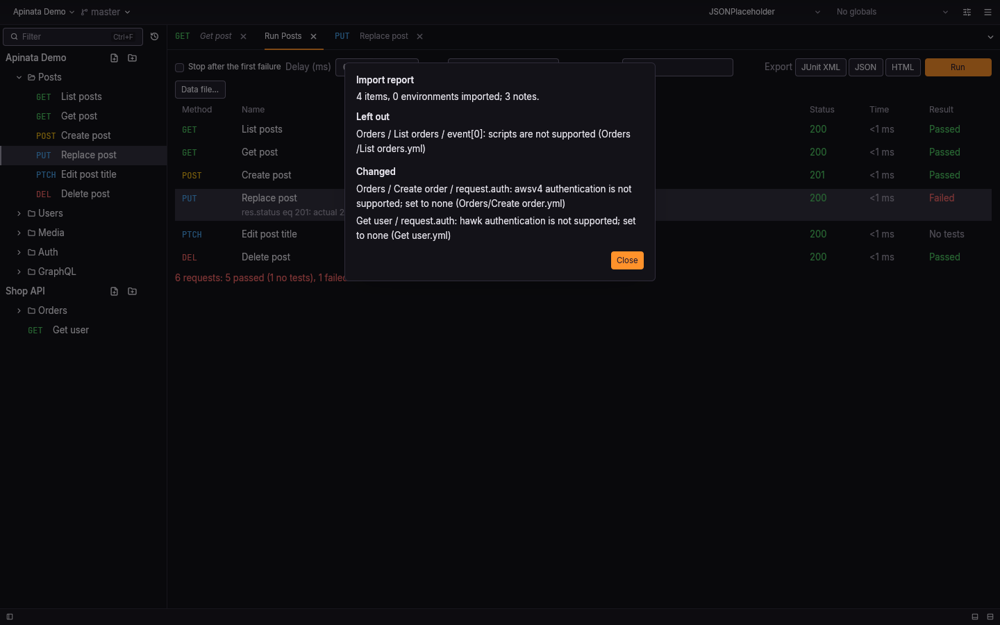

#  Apinata

Apinata is a native API client for HTTP, REST and GraphQL, written in Rust. It
also streams server-sent events. It is local-first: your requests are plain
YAML files on disk that live in git next to your code, with no account and no
cloud service. A team can share collections through a server it hosts itself.
There is no Electron and no webview, so it starts fast and stays light. The same core drives a desktop app,
a command-line runner and an MCP server for AI assistants. It is free and open
source under MIT or Apache-2.0.



## Features

- **Collections are plain files.** One YAML file per request, one folder per
  folder, environments beside them, all readable in a diff and meant for git.
  Changed requests are marked in the sidebar.

  

- **HTTP, GraphQL and server-sent events.** GraphQL requests fetch the schema
  by introspection, build queries from it in a builder panel, check queries
  against it as you type and run subscriptions over WebSocket. From the command
  line, `apinata graphql` fetches a schema and formats or checks a query. Event-stream responses show each event as it arrives. WebSocket
  and gRPC request files appear in the sidebar but cannot be opened or sent
  yet. On Linux and macOS, a URL such as `http://unix:/var/run/docker.sock:/info`
  sends over a Unix socket.

- **Many kinds of auth.** Basic, Bearer, JWT Bearer, API key, Digest, AWS
  SigV4, NTLM, OAuth 1.0, OAuth 2.0 (client credentials, password,
  authorization code with PKCE, and implicit), WSSE, Akamai EdgeGrid, Hawk and Atlassian ASAP. A cookie jar keeps
  cookies between requests.

- **AI through MCP.** An AI assistant can read and edit your collections and
  send requests through the built-in MCP server, `apinata mcp`. Edits are plain
  git-tracked files, and sending to a non-local host or a Unix socket needs your
  approval in the app, with a trusted-host list per collection.

  

- **Environments and secrets.** Switch environments in one click. Secret
  values stay in the system keychain, never in the collection files.

  

- **Team workspaces on your own server.** Join a self-hosted
  [Potluck](https://github.com/PhongGuy/potluck) team server, with a password
  or the server's single sign-on, to share collections as team workspaces. Saved changes sync in the background, the
  status bar shows the sync state, and when two people change the same request
  the app lets you compare both versions and keep one. Nothing leaves your
  machine unless you join a server.

- **Tests, scripts and a CLI runner.** Assertions and JavaScript scripts run
  in the app and from `apinata run`, with JSON, JUnit and HTML reports for CI.
  Scripts run before and after each request and can hold tests, with chai,
  crypto and JWT helpers. Data-driven runs repeat a collection once per row of
  a CSV or JSON file (`--csv-file-path`, `--json-file-path`). The app's runner
  can use the shared cookie jar, an empty one or a copy, and can drop the
  variable values a run sets.

  

- **Import and export.** Bring in collections from Postman (v2.0 and v2.1),
  OpenAPI 3 and Swagger 2.0, Insomnia (v4 and v5), Hoppscotch and HAR 1.2,
  environments from Postman and Hoppscotch, and single requests from curl.
  Export to Postman v2.1, OpenAPI 3.1 (JSON or YAML) or one HTML page, and
  record a run as HAR (`apinata run --har`). Details are in
  [Importing and exporting](GUIDE.md#importing-and-exporting).

  

- **Mock server and code generation.** `apinata mock` serves your saved
  examples, as does the app's Mock button in the status bar, and `apinata gen`
  prints a request as code: curl, HTTPie, raw HTTP, Python
  requests, JavaScript fetch, Node axios, Go, PowerShell, PHP, Ruby, Rust
  reqwest, Java, Kotlin, C# or Swift.

## Download and install

The links below always download the latest release. To build it yourself
instead, see [Build from source](CONTRIBUTING.md#build-from-source).

| Platform | Download |
| --- | --- |
| Linux x86_64 | [AppImage](https://github.com/PhongGuy/apinata/releases/latest/download/apinata-linux-x86_64.AppImage), [.deb](https://github.com/PhongGuy/apinata/releases/latest/download/apinata-linux-amd64.deb) |
| Linux arm64 | [AppImage](https://github.com/PhongGuy/apinata/releases/latest/download/apinata-linux-aarch64.AppImage), [.deb](https://github.com/PhongGuy/apinata/releases/latest/download/apinata-linux-arm64.deb) |
| macOS Apple silicon | [.dmg](https://github.com/PhongGuy/apinata/releases/latest/download/apinata-macos-aarch64.dmg) |
| macOS Intel | [.dmg](https://github.com/PhongGuy/apinata/releases/latest/download/apinata-macos-x86_64.dmg) |
| Windows x64 | [installer (.exe)](https://github.com/PhongGuy/apinata/releases/latest/download/apinata-windows-setup.exe) |

Each release on the [releases page](https://github.com/PhongGuy/apinata/releases)
also carries the command-line runner on its own for every platform, and a
`SHA256SUMS` file. The `.deb` installs both `apinata` and `apinata-app`. Every
file in a release is listed in [Release files](GUIDE.md#release-files).

### Signing and checksums

The macOS app is ad-hoc signed and not notarised, the Windows files are not
code-signed, and Linux has no OS signing; how this works is
in [RELEASING.md](RELEASING.md). `SHA256SUMS` lists the versioned file names,
not the fixed names the links above use, so check the versioned files:

```sh
sha256sum -c --ignore-missing SHA256SUMS
```

Every file also carries a build attestation, which proves this project's
release workflow built it. Check one with the GitHub CLI:

```sh
gh attestation verify <file> --repo PhongGuy/apinata
```

**macOS:** Gatekeeper blocks the first open. Right-click the app and choose
Open, or clear the quarantine flag:

```sh
xattr -dr com.apple.quarantine /Applications/Apinata.app
```

**Windows:** SmartScreen warns before the installer runs. Choose "More info",
then "Run anyway".

The macOS and Windows packages have not yet been tested on those systems.

## Quick start

### The desktop app

Start `apinata-app`, or pass it a collection folder: `apinata-app ./my-api`.
From its menu or command palette, choose Open collection for an existing one,
New collection to start in an empty folder, Import collection to bring one in
from another tool, or Clone repository to fetch one from git. To open your
team's workspaces, choose Join team server in the command palette. Pick an
environment in the title bar, open a request in the sidebar and send it.

To look around first, `make demo` builds the app from source and opens a
sample collection that talks to jsonplaceholder.typicode.com, on a copy under
`~/.cache/apinata-demo`, so your real settings stay untouched:

```sh
make demo
```

### The command line

Run every request in a collection with one of its environments, and supply a
secret from the shell:

```sh
apinata run ./my-api --env staging
TOKEN=abc123 apinata run ./my-api --env staging --env-var TOKEN
```

Run one folder or one request, print a response body, or write reports for CI:

```sh
apinata run ./my-api/users --env staging --bail
apinata run ./my-api/users/get.yml --body | jq .id
apinata run ./my-api --reporter-junit results.xml --reporter-html results.html
```

Start an empty collection, look around one and check it without sending anything:

```sh
apinata init ./my-api
apinata ls ./my-api
apinata check ./my-api --env staging
```

Send a one-off request, or bring in a collection from another tool:

```sh
apinata send https://api.example.com/users -X POST -H 'Content-Type: application/json' -d '{"name":"Ada"}'
apinata import collection openapi.yaml --into ./collections
```

Sign in to a team server from a terminal or CI; the password comes from stdin:

```sh
printf '%s\n' "$TEAM_PASSWORD" | apinata team sign-in https://team.example.com --username ada
apinata team status
```

The exit code is `0` on success, `1` when an assertion or check failed, `2`
when a request errored and `3` for a usage or setup error. Every
command, flag and code is in the [guide](GUIDE.md#command-line).

To run a collection in GitHub Actions or GitLab CI, with a checked download,
secrets from the CI and a JUnit report, see
[Running in CI](GUIDE.md#running-in-ci).

## How it works

### Collections are files

A collection is a directory of OpenCollection YAML: one file per request, a
`folder.yml` per folder, `environments/*.yml`, and `opencollection.yml` at the
root. Collections already saved in this format by other open-source API
clients open as they are, with no import. Collections in the older text
format [convert to YAML](GUIDE.md#legacy-bru-collections).

Because the files live in git, the app and the CLI show what changed since the
last commit (`apinata git status`, `apinata git diff`). The CLI also commits,
pulls and pushes (`apinata git commit`, `apinata git pull`, `apinata git
push`), an AI assistant can commit through the MCP server, and the app can
clone a repository, switch its branches, and pull and push.

### One core, three thin shells

All behaviour lives in one UI-free Rust crate, `apinata-core`: reading and
writing collections, resolving variables, sending requests, running scripts
and judging assertions. Three programs sit on top and only call it:

- `apinata-app`, the desktop app, built with GPUI;
- `apinata`, the command-line runner;
- `apinata mcp`, the MCP server, which ships inside the `apinata` binary.

So a request sends, and an assertion passes or fails, the same way in all
three.

### Environments and secrets

Environments are YAML files under `environments/`; global environments shared
by every collection live in your profile directory. A variable marked
`secret: true` keeps no value in the file. The app stores secret values in the
system keychain, and `apinata run` reads them from there when a request needs
one; `--env-var` supplies or overrides a value on the command line, and
`--no-keychain` skips the keychain. `{{process.env.NAME}}` reads a shell
variable, with a `.env` file at the collection root on top; keep that `.env`
out of git. A variable that cannot be resolved is an error: a literal `{{name}}`
is never sent.

### The MCP approval model

`apinata mcp` serves one collection to an AI agent over stdin and stdout:

```json
{"command": "apinata", "args": ["mcp", "--collection", "/path/to/my-api"]}
```

The agent may read and edit collection files freely, since git tracks every
change. Sending a request to a host other than `localhost` or a loopback
address, or to any Unix socket, needs your approval: the request waits until
you approve it in the desktop app, or you trust the host (or the socket, as
`unix:/path/to.sock`) beforehand. Denied hosts are refused outright.

```sh
apinata trust add api.example.com --collection ./my-api
```

The tools, resources and prompts the server offers are in
[MCP server](GUIDE.md#mcp-server).

## Reference

[GUIDE.md](GUIDE.md) is the full reference:

- [Working with collections](GUIDE.md#working-with-collections): naming the
  collection, git, search, check, list, environments, items and folders, host
  overrides, replace;
- [Command line](GUIDE.md#command-line): exit codes, completions, running,
  variables, reports, CI, sending, code generation, scripts, limits and reading
  responses;
- [Mock server](GUIDE.md#mock-server), [Desktop app](GUIDE.md#desktop-app),
  [Importing and exporting](GUIDE.md#importing-and-exporting),
  [Legacy collections](GUIDE.md#legacy-bru-collections),
  [MCP server](GUIDE.md#mcp-server), [Updates](GUIDE.md#updates);
- [Release files](GUIDE.md#release-files).

## Licence

MIT OR Apache-2.0

Licensed under either of

- Apache License, Version 2.0 ([LICENSE-APACHE](LICENSE-APACHE))
- MIT license ([LICENSE-MIT](LICENSE-MIT))

at your option.

The bundled fonts and icons keep their own licences, in `licenses/`.

## For developers

Apinata is written in Rust with [GPUI](https://www.gpui.rs/), so there is no
web view. To build it from source you need Rust 1.99 or newer, and on Linux
the system packages listed in [Requirements](CONTRIBUTING.md#requirements).
Then:

```sh
git clone https://github.com/PhongGuy/apinata.git
cd apinata
make demo
make check
```

`make demo` opens a sample collection on a throwaway profile, and `make check`
runs the formatting, lints and tests. Building, installing from source, the
checks, CI, the QA setup and how to send a change are all in
[CONTRIBUTING.md](CONTRIBUTING.md).

Issues and pull requests from anyone are welcome, first ones included; see
[Sending a change](CONTRIBUTING.md#sending-a-change).
