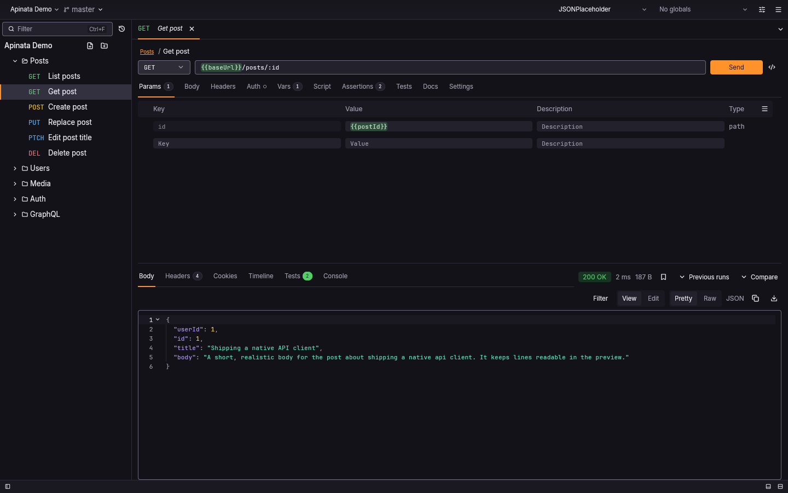
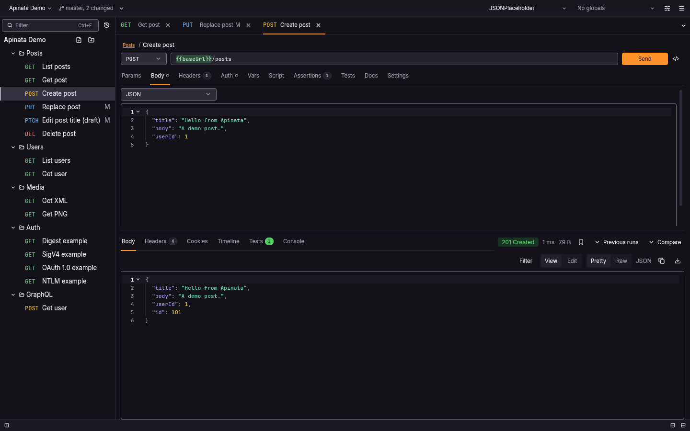
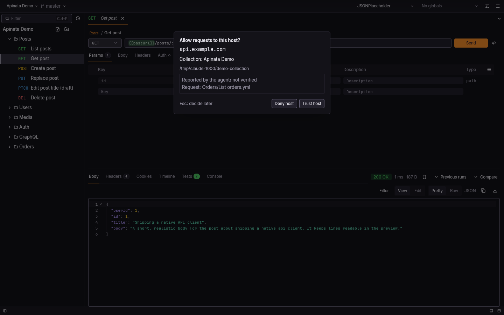
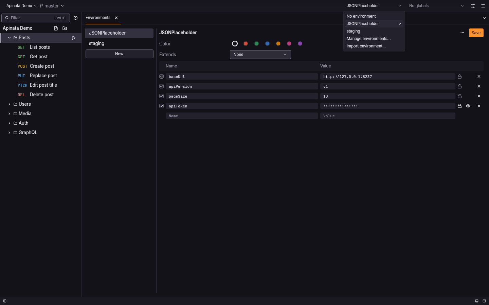
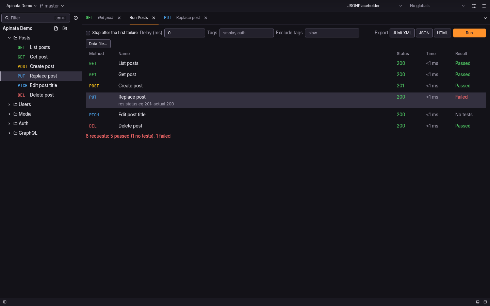
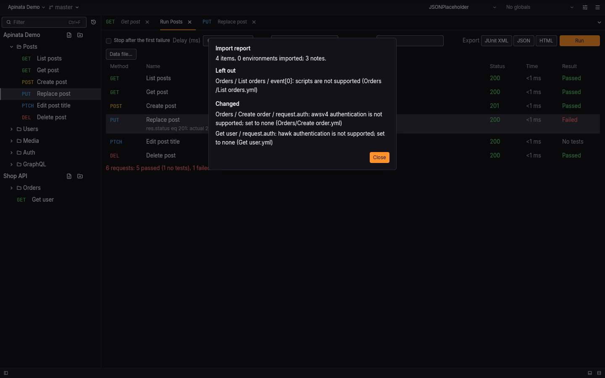

# Apinata

Apinata is a native API client for HTTP and REST, written in Rust. It is
local-first: your requests are plain YAML files on disk that live in git next to
your code, with no account and no cloud sync. There is no Electron and no
webview, so it starts fast and stays light. The same core drives a desktop app,
a command-line runner and an MCP server for AI assistants. It is free and open
source under MIT or Apache-2.0.



## Features

- **Collections are plain files.** One YAML file per request, one folder per
  folder, environments beside them, all readable in a diff and meant for git.
  Changed requests are marked in the sidebar.

  

- **AI through MCP.** An AI assistant can read and edit your collections and
  send requests through the built-in MCP server, `apinata mcp`. Edits are plain
  git-tracked files, and sending to a non-local host needs your approval in the
  app, with a trusted-host list per collection.

  

- **Environments and secrets.** Switch environments in one click. Secret
  values stay in the system keychain, never in the collection files.

  

- **Tests and a CLI runner.** Assertions and scripts run in the app and from
  `apinata run`, with JSON, JUnit and HTML reports for CI.

  

- **Import and export.** Bring in collections from other API clients,
  OpenAPI specs, HAR captures and curl commands; export to common formats and a
  single HTML page.

  

- **Mock server and code generation.** `apinata mock` serves your saved
  examples, and `apinata gen` prints a request as curl, Python, Go and more.

## Download and install

No release has been published yet. Until the first one, the download links
below do not resolve, and the way in is to [build from source](#build-from-source).

| Platform | Download |
| --- | --- |
| Linux x86_64 | [AppImage](https://github.com/PhongGuy/apinata/releases/latest/download/apinata-linux-x86_64.AppImage), [.deb](https://github.com/PhongGuy/apinata/releases/latest/download/apinata-linux-amd64.deb) |
| Linux arm64 | [AppImage](https://github.com/PhongGuy/apinata/releases/latest/download/apinata-linux-aarch64.AppImage), [.deb](https://github.com/PhongGuy/apinata/releases/latest/download/apinata-linux-arm64.deb) |
| macOS Apple silicon | [.dmg](https://github.com/PhongGuy/apinata/releases/latest/download/apinata-macos-aarch64.dmg) |
| macOS Intel | [.dmg](https://github.com/PhongGuy/apinata/releases/latest/download/apinata-macos-x86_64.dmg) |
| Windows x64 | [installer (.exe)](https://github.com/PhongGuy/apinata/releases/latest/download/apinata-windows-setup.exe) |

Each release on the [releases page](https://github.com/PhongGuy/apinata/releases)
also carries the command-line runner on its own for every platform, and a
`SHA256SUMS` file. The `.deb` installs both `apinata` and `apinata-app`. Every
file in a release is listed in [Release files](GUIDE.md#release-files).

### Signing and checksums

The macOS app is ad-hoc signed and not notarised, the Windows files are signed
with a self-signed certificate, and Linux has no OS signing; how this works is
in [RELEASING.md](RELEASING.md). `SHA256SUMS` lists the versioned file names,
not the fixed names the links above use, so check the versioned files:

```sh
sha256sum -c --ignore-missing SHA256SUMS
```

**macOS:** Gatekeeper blocks the first open. Right-click the app and choose
Open, or clear the quarantine flag:

```sh
xattr -dr com.apple.quarantine /Applications/Apinata.app
```

**Windows:** SmartScreen warns before the installer runs. Files built without
the project's signing certificate carry `-unsigned` in their names.

The macOS and Windows packages have not yet been tested on those systems.

### Build from source

You need Rust 1.99 or newer. On Linux, install the build packages first (the
Debian and Ubuntu names):

```sh
sudo apt-get install pkg-config libfontconfig-dev libfreetype-dev libwayland-dev libx11-xcb-dev libxkbcommon-x11-dev libvulkan1 libegl1
```

Then build and install the app and the CLI for the current user:

```sh
make install
```

- **Linux:** `apinata` and `apinata-app` go to `~/.local/bin`, with a launcher
  entry and icon under `~/.local/share`. Set `PREFIX` in the environment to
  install elsewhere, and `DESTDIR` to stage the files for a package.
- **macOS:** the app goes to `~/Applications/Apinata.app` and `apinata` to
  `~/.local/bin`.
- **Windows** (Git Bash or MSYS2): both programs go to
  `%LOCALAPPDATA%\Programs\Apinata`; add that folder to your `PATH`.

A bare `make` does the same. The MCP server needs no separate install: it is
`apinata mcp`. To remove everything again:

```sh
make uninstall
```

To build without installing, run `cargo build --release`; the binaries land in
`target/release/`. Packaging and the checks are in
[Building and packaging](GUIDE.md#building-and-packaging).

## Quick start

### The desktop app

Start `apinata-app`, or pass it a collection folder: `apinata-app ./my-api`.
From its menu or command palette, choose Open collection for an existing one,
New collection to start in an empty folder, Import collection to bring one in
from another tool, or Clone repository to fetch one from git. Pick an
environment in the title bar, open a request in the sidebar and send it.

To look around first, `make demo` builds the app from source and opens a
sample collection that talks to jsonplaceholder.typicode.com, on a copy under
`~/.cache/apinata-demo`, so your real settings stay untouched:

```sh
make demo
```

### The command line

Run every request in a collection with one of its environments, and supply a
secret from the shell:

```sh
apinata run ./my-api --env staging
TOKEN=abc123 apinata run ./my-api --env staging --env-var TOKEN
```

Run one folder or one request, print a response body, or write reports for CI:

```sh
apinata run ./my-api/users --env staging --bail
apinata run ./my-api/users/get.yml --body | jq .id
apinata run ./my-api --reporter-junit results.xml --reporter-html results.html
```

Look around a collection and check it without sending anything:

```sh
apinata ls ./my-api
apinata check ./my-api --env staging
```

Send a one-off request, or bring in a collection from another tool:

```sh
apinata send https://api.example.com/users -X POST -H 'Content-Type: application/json' -d '{"name":"Ada"}'
apinata import collection openapi.yaml --into ./collections
```

The exit code is `0` on success, `1` when an assertion or check failed, `2`
when a request got no response and `3` for a usage or setup error. Every
command, flag and code is in the [guide](GUIDE.md#command-line).

## How it works

### Collections are files

A collection is a directory of OpenCollection YAML: one file per request, a
`folder.yml` per folder, `environments/*.yml`, and `opencollection.yml` at the
root. Collections already saved in this format by other open-source API
clients open as they are, with no import. Collections in the older `.bru`
format [convert to YAML](GUIDE.md#legacy-bru-collections).

Because the files live in git, the app and the CLI show what changed since the
last commit (`apinata git status`, `apinata git diff`), and the app can clone a
repository and switch its branches.

### One core, three thin shells

All behaviour lives in one UI-free Rust crate, `apinata-core`: reading and
writing collections, resolving variables, sending requests, running scripts
and judging assertions. Three programs sit on top and only call it:

- `apinata-app`, the desktop app, built with GPUI;
- `apinata`, the command-line runner;
- `apinata mcp`, the MCP server, which ships inside the `apinata` binary.

So a request sends, and an assertion passes or fails, the same way in all
three.

### Environments and secrets

Environments are YAML files under `environments/`; global environments shared
by every collection live in your profile directory. A variable marked
`secret: true` keeps no value in the file. The app stores secret values in the
system keychain, and `apinata run` reads them from there when a request needs
one; `--env-var` supplies or overrides a value on the command line, and
`--no-keychain` skips the keychain. `{{process.env.NAME}}` reads a shell
variable, with a `.env` file at the collection root on top; keep that `.env`
out of git. A variable that cannot be resolved is an error: a literal `{{name}}`
is never sent.

### The MCP approval model

`apinata mcp` serves one collection to an AI agent over stdin and stdout:

```json
{"command": "apinata", "args": ["mcp", "--collection", "/path/to/my-api"]}
```

The agent may read and edit collection files freely, since git tracks every
change. Sending a request to a host other than `localhost` or a loopback
address needs your approval: the request waits until you approve it in the
desktop app, or you trust the host beforehand. Denied hosts are refused
outright.

```sh
apinata trust add api.example.com --collection ./my-api
```

The tools, resources and prompts the server offers are in
[MCP server](GUIDE.md#mcp-server).

## Reference

[GUIDE.md](GUIDE.md) is the full reference:

- [Working with collections](GUIDE.md#working-with-collections): naming the
  collection, git, search, check, list, environments, items and folders, host
  overrides, replace;
- [Command line](GUIDE.md#command-line): exit codes, completions, running,
  variables, reports, sending, code generation, scripts, limits and reading
  responses;
- [Mock server](GUIDE.md#mock-server), [Desktop app](GUIDE.md#desktop-app),
  [Importing and exporting](GUIDE.md#importing-and-exporting),
  [Legacy .bru collections](GUIDE.md#legacy-bru-collections),
  [MCP server](GUIDE.md#mcp-server), [Updates](GUIDE.md#updates);
- [Release files](GUIDE.md#release-files) and
  [Building and packaging](GUIDE.md#building-and-packaging).

## Licence

MIT OR Apache-2.0

Licensed under either of

- Apache License, Version 2.0 ([LICENSE-APACHE](LICENSE-APACHE))
- MIT license ([LICENSE-MIT](LICENSE-MIT))

at your option.

The bundled fonts and icons keep their own licences, in `licenses/`.
